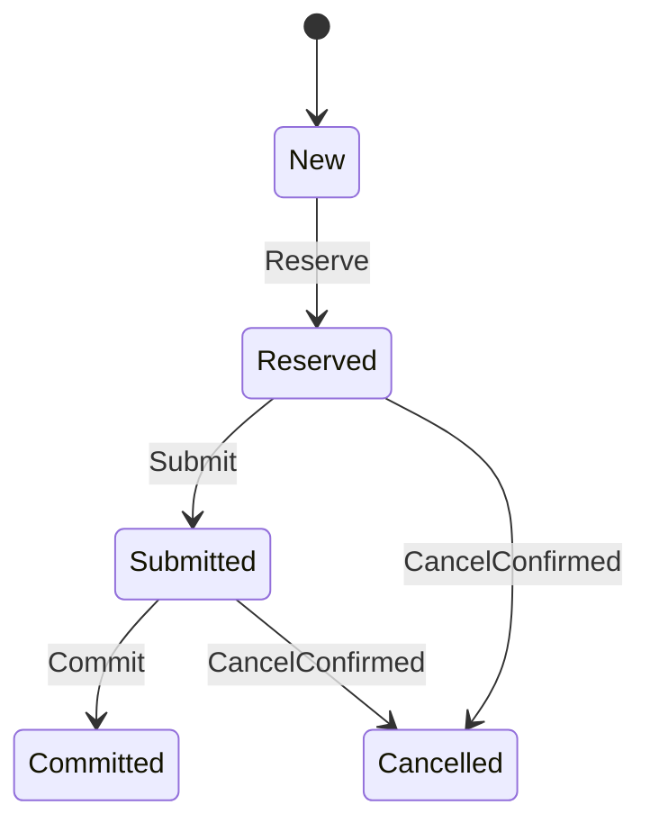

# Operational contract: staging, effect commitment and cancellation

This document fixes the interpretation of the existing sources. It adds no Event-B axiom, guard or event and changes none of the 109 proof obligations.

## Protected effect and control state

A **protected effect** is one modeled tool execution for a configured job. In the prototype it is represented by a tool_effects record and, for the publish tool, a local release_registry record. Staging metadata and audit writes are control-state changes, not that protected tool effect. The allowance counts unit-cost reservations plus already committed jobs, not money or real-time concurrency alone.

A **resource obligation** means an outstanding reservation in pending. It is not a deontic promise, a UCON obligation action, a provider charge, or a proof that a remote action may finish independently. The current model has no remote provider.

## Event contract

Let P=pending, C=committed, S=submitted and B=budget. The table omits typing and uniquely defined R/T helper parameters; the authoritative formulas are in docs/MODELS.eventb.txt.

| Event | Required state/authority | Protected state update | Protected tool effect |
|---|---|---|---|
| Delegate(a, scope) | a unissued; parent issued/live; child scope nonempty and within parent's scope | Extend issued/scope; recompute auth | None |
| Revoke(a) | a issued and not already revoked | Add a to revoked; recompute auth for the chain | None; historical effects stay recorded |
| Reserve(j) | j fresh; current owner/need authorized; used<B | P adds j; used increases by one | None |
| Submit(j) | j∈P\S; current owner/need authorized | S adds j; used, P and C unchanged | None; no provider dispatch |
| Commit(j) | j∈S⊆P; current owner/need authorized | Remove j from P/S; add j to C; effectCount(j) increases; used unchanged | Exactly one **modeled** effect at this atomic transition |
| CancelConfirmed(j) | j∈P; no current capability required for cleanup | Remove j from P/S; add j to cancelled; used decreases by one | No new tool effect; no refund after Commit |

State ownership, capability requirements and the parent tree are fixed context data. Delegate/Revoke are trusted control-plane events; the model does not authenticate who submitted an administrative request.

The diagram describes per-job control states, not delivery/completion states in a remote queue. Committed and Cancelled are terminal for that job identifier. Revocation affects authorization but does not itself change a job's stage.

## Revocation ordering

Effective revocation is the monitor's serialized Revoke transition, not the arrival time of an unmodeled network request. If Revoke(a) occurs before a candidate Commit(j), with a on path(owner(j)), and no authority restoration is possible, current auth excludes the required pair and Commit(j) is disabled. Reserve and Submit perform analogous current-authority checks.

If Commit(j) precedes Revoke(a), the earlier effect is legitimate under the earlier state and stays committed. The model does not undo it or require it to remain currently authorized afterward. Submission before revocation does not grandfather a later Commit: Submit grants no independent authority to complete.

The protected effect and the current-authority check must share the Commit linearization point. There is no modeled interval in which authorization has passed but another component can independently effectuate the operation after a subsequent revocation.

## What CancelConfirmed actually means

The Event-B event has a pending-membership guard; it does **not** validate a cancellation message, provider signature or remote status. Its name must not be used as evidence that those protocols were verified.

In the prototype the event is an **atomic local abort**. Since Submit never starts the local tool and Commit is serialized with cancellation, the monitor can remove the staged job and its reservation together. A later Commit is refused by the terminal phase. If Commit completed first, cancellation is refused. ToolAgent may request cancellation of its own configured job; Monitor.apply is a trusted internal API, not a public confirmation endpoint.

When discussing an external provider, “confirmed” is only an environmental interpretation requiring additional evidence and a refinement. The current sources have no CancelRequest, ProviderAck, UnknownOutcome or reconciliation protocol. Do not write that arbitrary remote cancellation confirmations are checked or guaranteed truthful.

## Assumptions and evidence boundaries

| ID | Assumption | What supports it / what is not proved |
|---|---|---|
| A1 | Trusted, well-typed configuration: finite rooted tree, immutable owner/need, unit-cost jobs | Event-B context axioms; one explicit Python consistency witness. Not runtime validation of arbitrary configurations. |
| A2 | Identity binding, authentic inputs and trusted grant/revoke control plane | Assumed. No authentication or token protocol is implemented/proved. |
| A3 | Complete mediation and protection of monitor/database state | Assumed. ToolAgent restricts its API, but it is not a sandbox or process-isolation proof. |
| A4 | One authoritative state order, with effect and check in the same atomic domain | Atomic Event-B events. Prototype uses one process, a shared lock and SQLite savepoints. Not distributed linearizability. |
| A5 | Submit cannot independently cause the protected effect | Defined by event actions; implementation stages a job and audit record only. No asynchronous external dispatch. |
| A6 | Commit's modeled effect corresponds to one local tool effect | Model effectCount and local SQL records; bounded tests. No code-level refinement theorem. |
| A7 | Cancellation reliably removes any ability to perform the local staged effect | Atomic local abort in this prototype. External provider confirmation/recovery is not modeled. |
| A8 | No reissuance/regrant, expiry, crashes or authority restoration in this version | Explicit scope restriction, not a security guarantee for those features. |

Cancellation after revocation is allowed to release an abandoned reservation, but no fairness assumption forces it to happen. A reservation can remain pending indefinitely; no availability/no-leak liveness theorem is claimed.

## SQL implementation boundary

A successful standalone apply call holds one RLock while checking state and executing the operation under a savepoint. For Commit, the local tool writes, tool_effects insertion and lifecycle changes share that transaction. The completed standalone transaction is the observation boundary. The finite test harness deliberately wraps trials in an enclosing savepoint to inspect and roll back states; it does not test external observers or cross-connection visibility.

A forced SQL insertion error demonstrates rollback within that local transaction and one effect after retry. It does not establish power-loss durability, recovery after an uncertain remote response, semantic deduplication across different job identifiers, or exactly-once delivery.

## Excluded interpretation and required extension

If Submit were reinterpreted as dispatching a request that a provider can execute without another authoritative check, the model would omit an effect-producing path. A hypothetical “dispatch; Revoke; provider executes” schedule is an illustration of that excluded environment, not a counterexample generated from this model.

To cover it, a future refinement would need separate dispatch/admission/outcome states, evidence binding to the exact operation, defined handling of unknown outcomes, provider/reconciler events, and a resource invariant that retains consumption or liabilities whenever an effect cannot be ruled out. Those states and proofs are not included in the present 109/109 result.
